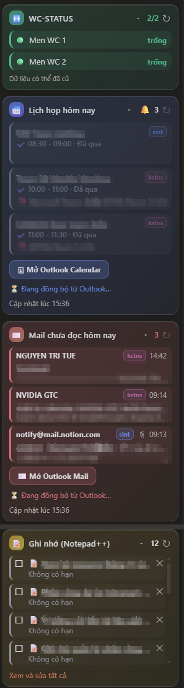
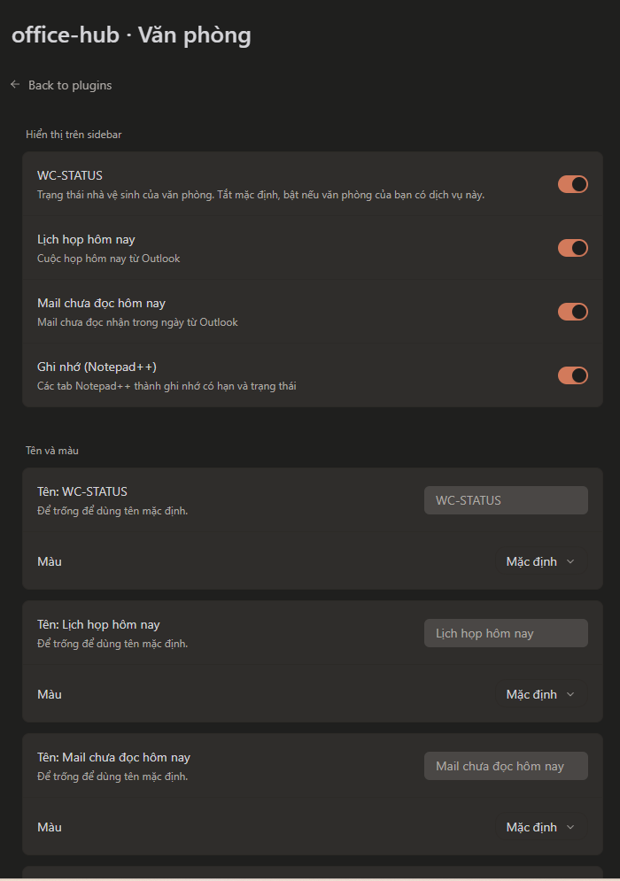
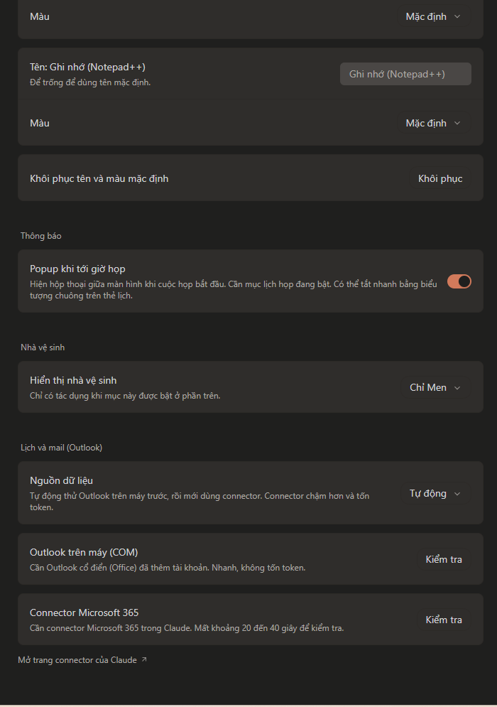

# Office Hub

Plugin cho [Paseo](https://paseo.sh) gom bốn thứ hay xem trong ngày làm việc vào sidebar: trạng thái nhà vệ sinh, lịch họp hôm nay, mail chưa đọc và các ghi nhớ lấy từ Notepad++. Mỗi mục là một thẻ kính mờ có thể mở rộng, đổi tên, đổi màu và bật tắt riêng.

<p align="center">
  
</p>

> Ảnh trên đã làm mờ tên và địa điểm cuộc họp, tiêu đề mail và ghi nhớ.

## Tính năng

| Mục | Làm gì |
| --- | --- |
| **WC-STATUS** | Hiện nhà vệ sinh nào đang trống hoặc bận, lấy từ trang Keystone Quest của văn phòng. Tắt mặc định. |
| **Lịch họp hôm nay** | Cuộc họp trong ngày của mọi tài khoản trong Outlook. Màu theo thời điểm: sắp tới, đang diễn ra, đã qua. Có link tham gia Teams, nút mở Outlook Calendar và popup giữa màn hình khi tới giờ họp. |
| **Mail chưa đọc hôm nay** | Mail chưa đọc nhận trong ngày, kèm nhãn tài khoản, giờ nhận và dấu file đính kèm. Có nút mở Outlook Mail. |
| **Ghi nhớ (Notepad++)** | Mỗi tab Notepad++ thành một ghi nhớ có tiêu đề, hạn chót, ô hoàn thành và nội dung sửa được. Nội dung mới gõ trong Notepad++ tự được nối xuống cuối ghi nhớ. |

Chi tiết từng mục:

- **Popup tới giờ họp**: hộp thoại giữa màn hình khi cuộc họp bắt đầu, có nút **Tham gia họp**, **Nhắc lại sau 5 phút** và **Đã biết**. Tắt nhanh bằng biểu tượng chuông cạnh tiêu đề thẻ lịch.
- **Ghi nhớ**:
  - Hạn chót có màu và biểu tượng theo mức khẩn: quá hạn, dưới 24 giờ, 1 đến 3 ngày, còn xa, không có hạn, đã xong.
  - Bấm vào một ghi nhớ trong sidebar để mở popup xem và sửa. Màn hình "Xem và sửa tất cả" sửa trực tiếp từng thẻ.
  - Dấu ✕ ẩn ghi nhớ khỏi Paseo, không đụng tới tab trong Notepad++. Có thể khôi phục trong mục "Đã xóa".
  - Ghi nhớ đã đánh dấu xong thì Notepad++ không cập nhật vào đó nữa.
  - Tiêu đề và hạn chót do bạn đặt luôn được ưu tiên hơn gợi ý của Claude.
- **Gọn trong sidebar**: toàn bộ các thẻ chiếm tối đa một nửa chiều cao cửa sổ, nội dung dài hơn cuộn bên trong (không hiện thanh cuộn) nên danh sách Workspaces bên dưới luôn còn chỗ. Mỗi danh sách hiện tối đa 4 dòng rồi cuộn.
- **Làm mới**: ghi nhớ đọc lại mỗi phút. Lịch và mail đọc lại khi dữ liệu cũ hơn 45 giây (qua Outlook trên máy) hoặc 5 phút (qua connector). Mỗi thẻ có nút ↻ để làm mới ngay.

## Yêu cầu

- Paseo 0.11 trở lên, đã bật plugin (Settings → Plugins → Enable plugins).
- Windows. Phần Notepad++ và nút mở Outlook chỉ chạy trên Windows.
- Với lịch và mail, một trong hai:
  - Outlook cổ điển (Office 2013 trở lên) đã thêm tài khoản. Nhanh, không tốn token. **Khuyến nghị.**
  - Connector Microsoft 365 trong Claude, cùng provider Claude trong Paseo. Chậm hơn và tốn token.
- Với ghi nhớ: Notepad++ (bản mặc định tự lưu phiên làm việc).

## Cài đặt

```bash
paseo plugin add git:trituenguyen97/paseo-office-hub
```

Repo này là private, nên máy cài phải có quyền đọc repo (đăng nhập Git hoặc có token). Hoặc cài từ thư mục đã tải về:

```bash
paseo plugin add /duong-dan/toi/paseo-office-hub
```

Cập nhật và gỡ:

```bash
paseo plugin update office-hub
paseo plugin remove office-hub
```

Plugin chạy mã không có sandbox trên máy bạn. Chỉ cài khi bạn tin nguồn.

## Bắt đầu nhanh

1. Mở **Settings → Plugins**, bấm `⋯` cạnh **office-hub**, chọn **Văn phòng**.
2. Ở **Hiển thị trên sidebar**, tick mục bạn muốn dùng. WC-STATUS tắt sẵn.
3. Ở **Lịch và mail (Outlook)**, bấm **Kiểm tra** cạnh *Outlook trên máy (COM)*.
   - Nếu báo chưa có tài khoản: bấm **Mở Outlook để đăng nhập**, thêm tài khoản công ty, rồi kiểm tra lại.
   - Không dùng Outlook cổ điển: bấm **Kiểm tra** cạnh *Connector Microsoft 365* và làm theo hướng dẫn nếu chưa kết nối.
4. Mở sidebar và bấm vào từng thẻ để xem.

<p align="center">
  
  
</p>

## Cài đặt

| Nhóm | Tùy chọn | Mặc định |
| --- | --- | --- |
| Hiển thị trên sidebar | Bật hoặc tắt từng mục | WC tắt, ba mục còn lại bật |
| Tên và màu | Tên riêng và màu cho từng mục (có sẵn bảng màu, hoặc nhập mã hex `#rrggbb`) | Tên và màu mặc định |
| Thông báo | Popup khi tới giờ họp | Bật |
| Nhà vệ sinh | Chỉ Men, chỉ Women, hoặc cả hai | Chỉ Men |
| Lịch và mail | Nguồn dữ liệu: Tự động, chỉ Outlook trên máy, chỉ connector | Tự động |

Chế độ **Tự động** thử Outlook trên máy trước. Nếu lỗi thì chuyển sang connector, rồi thử lại Outlook trên máy sau 10 phút.

## Cách hoạt động

```
Sidebar (Paseo app)  <--RPC-->  Plugin server (daemon)  -->  keystone-quest.pages.dev   (WC)
                                       |                -->  Outlook qua COM / PowerShell
                                       |                -->  Agent Claude + connector M365 (dự phòng)
                                       |                -->  %APPDATA%\Notepad++\session.xml và file backup
                                       '-- lưu dữ liệu riêng trong ~/.paseo/
```

- **Notepad++**: đọc `session.xml` và các file backup. Lần đầu thấy một tab, plugin sao nội dung vào Paseo. Sau đó mỗi phút so với bản đã thấy và nối các dòng mới xuống cuối nội dung ghi nhớ.
- **Tiêu đề và hạn chót gợi ý**: khi có ghi nhớ mới hoặc vừa sửa, một agent Claude (Haiku) chạy nền đề xuất tiêu đề ngắn và hạn chót nếu nội dung nói rõ.
- **Outlook (COM)**: một script PowerShell mở `Outlook.Application`, đọc Calendar và Inbox của mọi hộp thư trong profile, rồi trả JSON. Mất khoảng 2 đến 3 giây.
- **Mở Outlook**: New Outlook không có đường dẫn mở thẳng vào mục. Plugin mở ứng dụng rồi bấm nút Calendar hoặc Mail trên thanh trái bằng UI Automation.

## Dữ liệu và quyền riêng tư

Dữ liệu cá nhân nằm trên máy bạn, trong thư mục `~/.paseo/`:

| File | Nội dung |
| --- | --- |
| `wc-status-notes-store.json` | Nội dung ghi nhớ đã sao vào Paseo |
| `wc-status-notes.json` | Tiêu đề, hạn chót, trạng thái xong, trạng thái ẩn do bạn đặt |
| `wc-status-notes-ai.json` | Tiêu đề và hạn chót do Claude gợi ý |
| `wc-status-cal.json`, `wc-status-mail.json` | Lịch và mail hôm nay đã đọc |
| `wc-status-alerted.json` | Các popup họp đã báo |
| `wc-status-open.log` | Nhật ký của nút mở Outlook |

Plugin gửi dữ liệu ra ngoài ở các chỗ sau:

- **WC-STATUS** gửi một yêu cầu GET tới `https://keystone-quest.pages.dev/api/wc-status`, không kèm thông tin đăng nhập.
- **Gợi ý tiêu đề và hạn chót** gửi tối đa 4000 ký tự đầu của mỗi ghi nhớ mới hoặc vừa sửa tới provider Claude đã cấu hình trong Paseo. Hãy đặt tiêu đề và hạn chót thủ công nếu ghi chú chứa thông tin không được gửi đi.
- **Đọc Outlook bằng connector** cho một agent Claude xem tiêu đề, người gửi, đoạn xem trước của mail và tiêu đề cuộc họp. Agent chạy ở chế độ `bypassPermissions`, bị giới hạn chỉ gọi hai công cụ tìm kiếm của connector, và được dặn không làm theo chữ trong thư. Đây là lời dặn chứ không phải chặn kỹ thuật, nên chỉ dùng chế độ này khi bạn chấp nhận rủi ro đó.
- Đọc Outlook qua COM không gửi gì ra ngoài.

Plugin không có telemetry và không lưu mật khẩu hay token.

## Giới hạn đã biết

- Chỉ Windows.
- Popup họp chỉ hiện khi app Paseo đang mở và mục lịch đang bật.
- Mail chỉ gồm thư chưa đọc nhận trong ngày hôm nay.
- Với New Outlook, nút mở Calendar và Mail dựa vào giao diện của nó và có thể hỏng khi Microsoft đổi giao diện.
- Trạng thái đọc mail lấy từ Outlook cổ điển có thể lệch New Outlook một lúc do độ trễ đồng bộ.
- Đọc qua connector chậm (khoảng 20 đến 40 giây mỗi lần) và chỉ đọc tài khoản mặc định.
- Tab Notepad++ đã đóng biến khỏi danh sách nhưng dữ liệu vẫn nằm trong `wc-status-notes-store.json`.

## Khắc phục sự cố

| Triệu chứng | Cách xử lý |
| --- | --- |
| Thẻ lịch hoặc mail báo lỗi | Vào Settings → Văn phòng và bấm **Kiểm tra** để biết thiếu gì. |
| Plugin không chạy | `paseo plugin ls`, rồi `paseo plugin logs office-hub`. |
| Sửa mã nhưng giao diện không đổi | `paseo plugin reload office-hub`, rồi tải lại app (Ctrl+R). |
| Nút mở Outlook không phản ứng | Xem `~/.paseo/wc-status-open.log` để biết nó dừng ở bước nào. |
| Mở Outlook cổ điển hiện cửa sổ cài đặt | Outlook chưa có tài khoản. Thêm tài khoản rồi bấm Kiểm tra lại. |

## Phát triển

```bash
npm install --legacy-peer-deps
npm run typecheck   # tsc --noEmit
npm test            # node --test, các hàm thuần
npm run check       # cả hai
```

Cấu trúc:

```
index.client.tsx   đăng ký sidebar, màn hình cài đặt, panel
index.server.ts    đăng ký RPC và cài đặt phía daemon
client/            giao diện (React Native): thẻ sidebar, popup, màn hình cài đặt
server/            logic chạy trên daemon: Outlook, Notepad++, agent, cảnh báo họp
shared/            hợp đồng RPC (zod) và cài đặt, dùng chung hai phía
test/              kiểm thử các hàm thuần
assets/            ảnh chụp dùng trong tài liệu
```

Sau khi sửa mã server, chạy `paseo plugin reload office-hub`. Sau khi sửa mã client, tải lại app. Mã client chỉ dùng thành phần React Native và màu lấy từ theme, nên chạy được trên desktop và mobile.

## Phiên bản

Xem [CHANGELOG.md](CHANGELOG.md).
